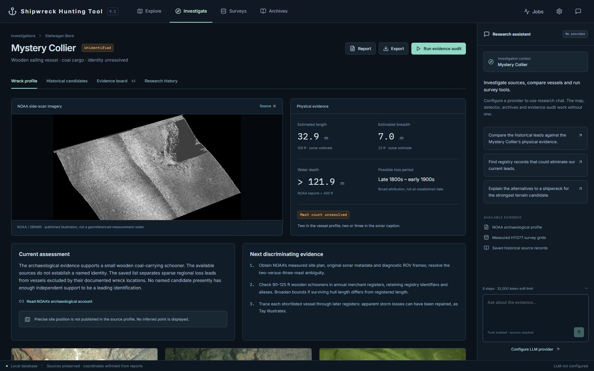
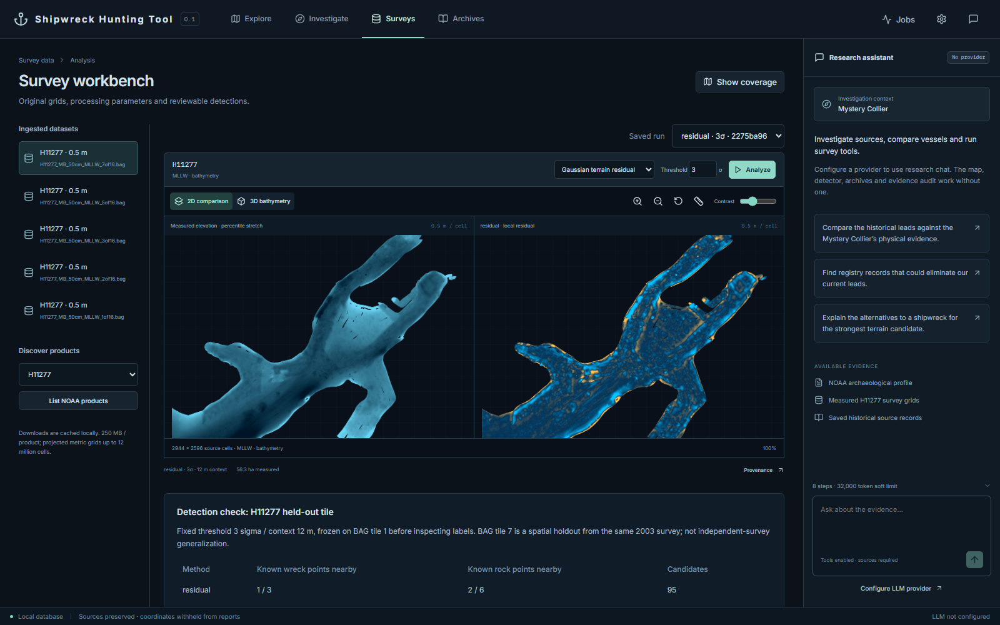

# Shipwreck Hunting Tool

Local maritime investigation workbench. Opens directly to a map with real NOAA survey footprints, catalogue wreck records, and computed terrain candidates. Python/FastAPI, SQLite, Rasterio/SciPy, React/TypeScript, MapLibre and Three.js. No paid service is required for the map, archive search, evidence audit, survey analysis or reports.





## Start

From this directory:

```powershell
python start.py
```

Or on Windows: `.\start.ps1`. Open **http://127.0.0.1:8787**. Ctrl+C stops the server. The starter creates the virtual environment, installs pinned Python dependencies and builds the frontend when needed. It never starts a public listener.

If that port is occupied, use `python start.py --port 8788` or `.\start.ps1 --port 8788`. Same-origin browser actions work on the selected port; other local services are left alone.

Requires Python 3.12+ (tested with 3.13.15), Node.js 22+ and npm for a fresh frontend build. Rasterio binary wheels include GDAL; no separate database or Docker installation is needed. Initial package installation needs internet access. Subsequent startup uses saved data. The ocean basemap and new source searches need internet; the saved coastline and research data remain local.

## Investigations

Use **New investigation** in the bar below the navigation. Enter a name, an optional research area and an objective. It starts empty; choose a map area, save sources in Archives, then add source-linked evidence or use the assistant. The selector changes the context across every page and is remembered on reload.

Map records, surveys, grids, detections, archive sources, historical vessels, notes, jobs, history and reports are scoped to the selected investigation. New downloads can reuse cached originals without attaching unrelated evidence. A research area can be saved from Explore. Provider settings are shared application settings.

Mystery Collier is the labelled example investigation. Your investigations, research notes, downloads and reports stay in the ignored `data/` directory. The repository contains application code and public example material; personal research should not be added to scripts, documentation or test fixtures.

## Try the example

1. Select **Mystery Collier (Sample)** to inspect the published wreck profile, historical vessel comparisons and conflicting source claims.
2. Use **New investigation** to start your own research with an empty workspace.
3. Use **Explore** to select and save bounds, discover surveys or refresh regional wreck records. **Archives** saves sources to that investigation, and **Evidence board** adds claims with source locators. Report and Export use the selected investigation.
4. The research assistant uses the selected investigation. Configure a tool-capable provider/model to use chat; keys remain in the OS credential manager. Manual evidence work, archive search and the saved-evidence audit work without an LLM. New-investigation audits review saved evidence; they do not silently launch the original Collier archive searches.

## Connect Claude or a local model through MCP

Start (or restart) `python start.py`. The app now serves **Streamable HTTP MCP at http://127.0.0.1:8787/mcp** alongside the website. An MCP-capable client can search archives, retrieve and search source documents, compare vessels, save unreviewed notes, queue survey ingestion/analysis, inspect or cancel jobs, and read the report. The client runs its own research loop; no provider or API key needs to be configured in this app.

For Claude Desktop or another client that launches stdio servers, generate configuration with your actual absolute paths:

```powershell
.venv\Scripts\python mcp_stdio.py --print-config
```

Merge the printed `shipwreck-hunter` entry into your client's `mcpServers` configuration, keeping any existing servers, then restart/reconnect the client. Keep the app running. The stdio launcher connects to the same app process and database. For local models, use a tool-capable model in a host that supports MCP; a bare model inference endpoint is not an MCP client.

See [MCP setup, available tools and example research request](docs/MCP.md). All executed MCP tool calls appear in **Jobs** with their arguments and results; new source-backed notes appear in the report as unreviewed. There is no shell, credential-management or publishing tool.

## What the saved evidence establishes

The Mystery Collier remains unidentified. Its source-backed profile, five comparative vessel records, historical registry OCR and a ranked list of sparse leads/exclusions are saved. **There is no defensible leading named identity yet.** Actor and Active have incomplete specifications and spatial mismatches; Tay, Frank A. Palmer and Louise B. Crary are exclusions, not proposed solutions. The generated report is written locally to `data/exports/mystery-collier.md`.

Five real 0.5 m NOAA H11277 BAG tiles from Gloucester Harbor have been ingested and analyzed. This is a separate site from Mystery Collier. The classical detectors produce terrain-screening candidates, not shipwreck classifications. On nine selected report points in a held-out tile, residual screening put candidate extents within 10 m of 1/3 wreck and 2/6 rock points; top-hat screening gave 0/3 and 5/6. This deliberately visible result demonstrates missed wrecks and geological false positives. **No new wreck has been validated.** Protocol and results are written locally to `data/exports/detection-evaluation.json`.

## Reproduce and test

```powershell
.venv\Scripts\python -m pytest -q
.venv\Scripts\python -m scripts.evaluate
.venv\Scripts\python -m scripts.export_snapshot
cd frontend
npm run build
node validate.mjs
```

The browser smoke test requires Chrome and the server on port 8787. Unit/integration tests isolate their database. They include a real saved BAG, geometric correctness, nodata handling, catalogue uncertainty, conflicting claims, credential redaction, provider message formats and checkpoint resumption. Provider adapters are tested with recorded-shape fixtures; no live paid model call has been made.

`python -m scripts.seed` reconstructs the initial demonstration from the saved `data/research` snapshots and five original BAG files (and fetches missing source documents). **Use a backup or a separate data directory when rebuilding**: it refreshes seeded site/vessel records, while source claims remain append-only. `scripts.evaluate` reuses matching fixed-parameter runs. All source data and demonstrations are already saved; normal startup does not rerun them.

For development, run `.venv\Scripts\python -m uvicorn backend.main:app --host 127.0.0.1 --port 8787 --reload` and `npm run dev` inside `frontend`. The Vite proxy uses port 5173. API docs: http://127.0.0.1:8787/docs.

## Scope and limits

- Supports north-up projected metre BAG and GeoTIFF grids. Large originals are automatically registered as overlapping source windows (normally 2,000 × 2,000 pixels with 100-pixel overlap), each below the 12-million-cell processing limit. Empty windows are skipped; originals and their hashes remain intact. Optional ingestion bounds select processing coverage, not downloaded bytes. A maximum of 512 windows requires larger products to use a smaller region. Geographic, rotated or unreferenced rasters still require documented reprojection.
- Downloads default to a 250 MB per-product limit, explicitly adjustable up to 1 GB in the workbench or MCP. This is not a campaign-wide budget. Inspect a product to check its cached metadata or remote HTTP size before downloading; remote grid dimensions and valid coverage are only available after download. Repeating ingestion reuses the cached bytes and deterministic window IDs.
- New detector runs save every eligible candidate. The workbench and MCP page results and filter review status. Older capped runs are labeled and retain their original reviews; rerunning does not migrate reviews automatically. Overlapping windows and repeated runs may contain duplicate objects. Catalogue proximity distinguishes close high-quality positions from broad uncertainty buffers, but neither automatically identifies a wreck.
- Side-scan GeoTIFF supports intensity screening; raw XTF/JSF/swath decoding, sonar slant-range correction and trained hull/shadow recognition are not implemented. The tested end-to-end demonstration is multibeam bathymetry.
- For uint8 RGB sidescan display mosaics, all-white pixels and zero alpha are treated as uncovered using an explicit heuristic. RGB channels are not interpreted as elevation uncertainty. Inspect the source mask/datum; opaque white can also conceal saturated returns, and missing coverage is not seabed absence.
- No calibrated probabilities, trained ML model, exhaustive ground truth or independent-survey generalization claim. Report feature point checks are limited, and candidate extent proximity does not prove object equivalence. Grid cell size is not absolute positional accuracy.
- Archive searches retrieve real catalogue records and documents, not a complete vessel/casualty census. OCR column order can be wrong. Some historical scans returned 403 or TLS errors. The app records inaccessible sources without inventing their contents.
- Two background workers; cancellation at network/processing checkpoints; configurable soft step/token/wall budgets. A running network call can delay cancellation. Analysis restarts deterministically on resume; transfers resume only with an HTTP validator. Research resumes completed steps/tool calls. A crash during a mutating tool can replay that tool; inspect history before resuming.
- Chat requires a configured tool-capable provider. Some models have different token parameters or lack tool support and will return an explicit provider error. No price/cost ceiling can be guaranteed from tokens alone. Prompts and selected evidence are sent to the chosen provider.
- Historical overlays, raw sonar decoding, BOEM/ENC ingestion and ML training are future work. See [source and methods research](docs/SOURCES.md) and [architecture](docs/ARCHITECTURE.md).

## Data and credentials

`data/raw` contains original survey products; `sources` holds content-addressed original bytes and extracted text; `derived` holds analytical artifacts; `research` holds acquisition snapshots; `exports` holds reports and evaluation results. SQLite stores records, original claims, research history, jobs and settings **without credentials**. The initial database and raw demonstration files are part of this local deliverable; keep them when moving the project. Additional downloaded probe tiles remain in `raw` for inspection but are not all ingested.

Back up `data` after stopping the server, or use SQLite's backup API. `scripts.export_snapshot` produces a credential-free portable record snapshot; do not publish it automatically because catalogue/candidate coordinates remain in local records. The human-readable investigation report withholds coordinates. No public publishing or heritage-authority messaging is performed. Seek expert archaeological review before describing an anomaly as a wreck or an identity as established. Keep the service on loopback: this version has no multi-user authentication.
